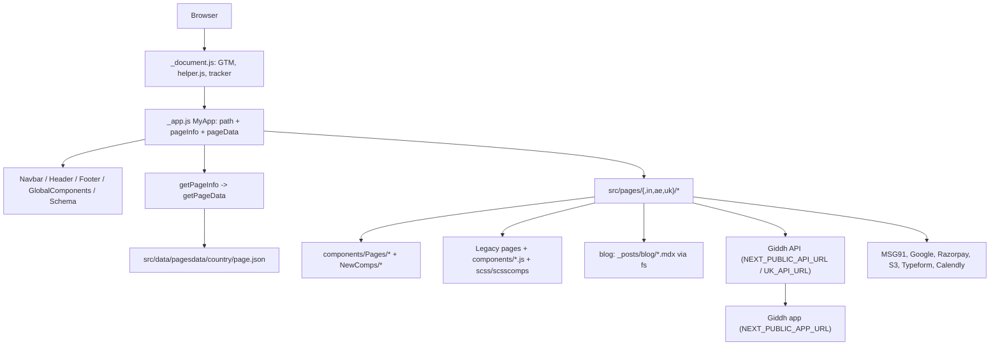

# Architecture & Mental Model

A Next.js 16 pages-router site in plain JavaScript (React 19, Bootstrap 5 + SCSS). There is no API client, global store or server code of its own. Almost every route is prerendered to static HTML at build time; the exceptions are the blog index and tag pages, which use `getServerSideProps`. Locale is the first URL segment (`/in`, `/ae`, `/uk`, or none for global). Per-page copy comes from either JSON in `src/data/pagesdata/` or hand-written JSX. Forms and pricing call the Giddh API and third parties straight from the browser with `fetch`. Purpose and non-goals are in [VISION.md](VISION.md), and the reasons behind these choices are in [DECISIONS.md](DECISIONS.md).

## System Overview & Mental Model



## Entry Points & Bootstrap Sequence

1. **Entry File:** `src/pages/_document.js:Document`, then `src/pages/_app.js:MyApp` for every route.
2. **Bootstrap Steps:**
   - Step 1 (`src/pages/_document.js:Document`): the `<Head>` holds the inline GTM snippet (`GTM-K2L9QG`), a blocking `<script src="/js/helper.js">` (`public/js/helper.js`) and an async `https://main.d2f49esifpcbwh.amplifyapp.com/tracker.js`. The body has the GTM `<noscript>` iframe. When `helper.js` loads it immediately runs `setUtmParamInLocalStorage()`, `setUtmParamsInCookies()` and `redirectPhpLink()`, and it defines globals such as `setCookie`, `getCookie`, `setGiddhRegion`, `addOtpWidgetScript` and `openCalendly` that React code calls through `window`.
   - Step 2 (`src/pages/_app.js:MyApp`): imports `src/scss/global.scss` and `bootstrap/dist/css/bootstrap.css` globally. It loads the Bootstrap JS bundle inside `useEffect` with `require("bootstrap/dist/js/bootstrap.bundle.min.js")`, so it is client-only and runs after hydration. <!-- verify:ignore -->
   - Step 3 (`MyApp`): builds the `path` object from `router.asPath`:
     ```js
     { country, linkPrefix, baseURL /* NEXT_PUBLIC_SITE_URL || "https://giddh.com" */,
       page, isGlobal, isIndia, isAE, isUK }
     ```
     `country` is `"global"` | `"in"` | `"ae"` | `"uk"`. `linkPrefix` is `""` or `"/in"` and so on. Every page and the chrome components get it as the `path` prop.
   - Step 4 (`MyApp`): takes the last path segment, minus any query string, and hides `Navbar` and `Footer` when it is `login`, `signup`, `chartered-accountant-signup`, `online-accounting-software`, `thank-you` or `googleauth`. This applies in every locale and to `/v2/login`.
   - Step 5 (`MyApp`): strips the `#` and `?` parts from `router.asPath` to get `rawPath`. `src/utils/getPageInfo.js:getPageInfo` turns it into `{country, folder, page, path}`, and `src/utils/getPageData.js:getPageData` turns that into `pageData` (see [Locale & Page Systems](#locale--page-systems)).
   - Step 6 (render order): `Navbar` (conditional), `src/components/header.js:Header`, the page `<Component path pageData pageInfo {...pageProps}>`, `Footer` (conditional), `src/components/globalComponents.js:globalComponents`, `src/components/NewComps/Schema/index.js:Schema` (given `pageData.schemas` and `pageData.faqs`), then `src/components/toastify.js:Toastify`.
   - `Header` handles meta and SEO. It looks up `<title>`, description, keywords, OG tags and canonical in `src/data/metadata.json`, keyed by the exact path (`"/in/pricing"`). It renders hreflang alternates only for the pages listed per locale in `src/data/hrefLangTag.json`. It adds `noindex` on `/v2/login`, but only after mount (`useEffect`), so the static HTML lacks it.
   - `globalComponents` renders `DownloadFreeModal` and the back-to-top button on every page except `/online-accounting-software`. `Schema` emits JSON-LD and builds a `FAQPage` schema from `faqs` when `schemas` contains none.

> [!NOTE]
> Four separate parsers read the locale out of the URL: the `path` block in `src/pages/_app.js:MyApp`, `src/utils/getPageInfo.js:getPageInfo`, the path logic inside `src/components/header.js:Header`, and `public/js/helper.js:getCurrentSiteCountry` / `getCurrentSiteCountryUrl`. They disagree at the edges. `MyApp` computes `page` from the raw `asPath`, so `/in?x=1` yields `page: "in?x=1"` while `getPageInfo` yields `country: "in", page: "home"`. When changing locale detection, update all four or merge them.

## Major Modules & Responsibilities

| Module / Layer | Path | Core Responsibility | Sources of Truth | May Depend On | Must NOT Depend On |
|---|---|---|---|---|---|
| Routing / Pages | `src/pages/` (+ `src/pages/in/`, `src/pages/ae/`, `src/pages/uk/`, `src/pages/blog/`, `src/pages/v2/`) | One file per URL. Thin locale wrappers or full legacy pages | URL (`router.asPath`) → `path`, `pageInfo` | `src/components/`, `src/data/`, `src/utils/`, `src/hooks/` | Next API routes (none exist; adding them is a non-goal, see [VISION.md](VISION.md)) |
| App shell | `src/pages/_app.js`, `src/pages/_document.js`, `src/components/header.js`, `src/components/navbar.js`, `src/components/footer.js`, `src/components/globalComponents.js` | Global CSS/JS, scripts, meta/hreflang, nav, footer, download modal | `src/data/metadata.json`, `src/data/hrefLangTag.json` | `public/js/helper.js` globals, `src/utils/s3Config.js` | Page-specific data |
| Page compositions | `src/components/Pages/` | One component per JSON-driven page type, composing sections from `pageData` | `pageData` prop | `src/components/NewComps/` | Direct `fetch`; locale checks (the locale is in the JSON choice) |
| Section components | `src/components/NewComps/` | Reusable sections (Banner, CTA, FAQs, Features, Stats, forms, Schema…), some with CSS modules (e.g. `src/components/NewComps/FAQs/FAQs.module.scss`) | Props (`compData`, `features`, `faqs`…) | `src/utils/`, `src/hooks/` (forms only) | `src/data/pagesdata/` imports (content comes in via props) |
| Legacy components | `src/components/*.js` (e.g. `src/components/bannerSection.js`, `src/components/featureGallery.js`, `src/components/makeTheSwitch.js`, `src/components/clientSummary.js`, `src/components/otpVerifyModal.js`, `src/components/googleLogin.js`) | Hand-written sections and auth widgets used by legacy pages | Inline JSX copy + the `path` prop | `src/scss/scsscomps/`, `public/js/helper.js` globals | — |
| Content data | `src/data/pagesdata/{global,in,ae,uk}/*.json`, `src/data/*.json`, `_posts/blog/*.mdx` | Page copy, FAQs, schemas, metadata, pricing feature rows, blog posts | These files | — | — |
| Utilities / hooks | `src/utils/`, `src/hooks/`, `public/js/helper.js` | Route parsing, page-data loading, OTP widget, UTM capture, S3 download URLs, Segmento push, signup helpers, experiment helpers (`src/utils/experiments.js`) | Cookies, localStorage, env vars | Browser APIs | React components |
| Blog | `src/pages/blog/`, `src/components/blogs/` | MDX listing, post, tag and pagination pages | `_posts/blog/`, `config.js` (`posts_per_page` only) | `fs` (server/build only) | Client-side `fs` (`next.config.js` stubs it to `false`) |

## Locale & Page Systems

A locale is a folder: `src/pages/` (global), `src/pages/in/`, `src/pages/ae/` and `src/pages/uk/`, with no Next i18n ([DECISIONS.md ADR-002](DECISIONS.md#adr-002-locales-as-mirrored-page-folders-not-next-i18n)). A locale page file is one of three kinds:

- **Re-export of a shared composition:** `src/pages/ae/triggers.js` renders `src/components/Pages/Triggers.js`.
- **Wrapper around another page file:** `src/pages/ae/pricing.js` renders `src/pages/pricing.js` with `path={path.path}`. `src/pages/uk/pricing.js` renders `src/pages/in/pricing.js`, which renders `src/pages/pricing.js` again. `src/pages/ae/cloud-accounting-software.js` renders `src/pages/uk/cloud-accounting-software.js`.
- **A page of its own:** for example `src/pages/ae/index.js` and `src/pages/uk/index.js`, built from `src/components/bannerSection.js`, `src/components/featureGallery.js`, `src/components/clientSummary.js`, `src/components/makeTheSwitch.js` and FAQs from `src/data/faqs.json`; `src/pages/ae/vat.js`, `src/pages/uk/vat.js`, `src/pages/uk/inventory-management-software.js`; and the India-only pages `src/pages/in/bank-integration.js`, `src/pages/in/gst.js` and `src/pages/in/e-invoice.js`.

`pageData` is chosen by **URL, not by page file**. A locale file that wraps a global page still gets that locale's JSON: `/ae/affiliate` loads `src/data/pagesdata/ae/affiliate.json` even though `src/pages/ae/affiliate.js` only re-exports `src/pages/affiliate.js`.

| Page system | Chain | Copy lives in | Styling | Examples |
|---|---|---|---|---|
| (1) JSON-driven | page file → `src/components/Pages/` (one file per page type) → `src/components/NewComps/` sections, fed `pageData?.<key>` | `src/data/pagesdata/<country>/<page>.json` (top-level keys such as `splitBanner`, `features`, `cta`, `faqs`, `schemas`; the JSON shape is documented in [CONTRACTS.md](CONTRACTS.md)) | Bootstrap utilities + `src/components/NewComps/**/*.module.scss` (see [DESIGN.md](DESIGN.md)) | `src/pages/index.js` → `src/components/Pages/Home.js`; `src/pages/customer-portal.js` → `src/components/Pages/CustomerPortal.js` |
| (2) Legacy hand-written | page file with inline JSX copy, plus `src/components/*.js` sections | The page file itself (and `src/data/faqs.json`, `src/data/pricingData.json`, `src/data/data.json` where imported) | Global SCSS from `src/scss/scsscomps/*` imported via `src/scss/_import.scss` | `src/pages/about.js`, `src/pages/pricing.js`, `src/pages/signup.js`, `src/pages/invoice-software.js`, `src/pages/ae/index.js` |

How `getPageData` resolves (`src/utils/getPageData.js:getPageData`):

1. If `pageInfo.page` is not in the hard-coded `pagesToGetData` array (25 slugs), it returns `null` and loads nothing.
2. Otherwise it builds ``const filePath = `@/data/pagesdata/${country}/${page}.json` `` and calls `require(filePath)`. The bundler resolves this at build time (the build passes on Turbopack, see `next.config.js`).
3. `folder` from `getPageInfo` is ignored, so `/<folder>/<page>` URLs look up `<country>/<page>.json`.

> [!WARNING]
> `getPageData` fails silently. A slug missing from `pagesToGetData`, a missing `src/data/pagesdata/<country>/<page>.json`, or a JSON syntax/require error all return `null`, because the `catch {}` swallows the error. The page then renders with `pageData === null`, and every `pageData?.x` section receives `undefined`. Most NewComps render empty or nothing, with no build error. When you add a JSON-driven page or a locale variant, add the slug to `pagesToGetData`, create the JSON for **each** country that has the route, and check the built HTML for the copy. Today `/ae` and `/uk` have no `home.json` and get `null`, which is harmless only because `src/pages/ae/index.js` and `src/pages/uk/index.js` are legacy pages.

> [!WARNING]
> `Schema` takes `schemas` (plural). `src/pages/in/financial-reporting.js` passes `<Schema schema={schema} />`, so its inline WebPage/Service JSON-LD is never rendered. Only the `_app` call with `pageData.schemas` takes effect. `src/pages/in/all-features.js` uses the prop correctly.

## Rendering Strategy & Boundaries

- **Rendering Pattern:** pages-router static generation. The `next build` output (`build-after` run, Next 16.4.3, Turbopack) generates 402 pages. All non-blog routes are `○` (Static, no data functions; `_app` computes `pageData` synchronously while prerendering). Blog posts are `●` SSG: `src/pages/blog/[slug].js` (`getStaticPaths` with `fallback: false` + `getStaticProps`, reading MDX with `fs` and `gray-matter`, and throwing to fail the build when a slug has no file) and `src/pages/blog/page/[page].js`, both via `src/components/blogs/lib/posts.js:fetchPostContent` and `listPostContent`. **Exceptions:** `src/pages/blog/index.js` and `src/pages/blog/tags/[[...slug]].js` use `getServerSideProps` and show as `ƒ` (Dynamic), so they render per request on the host.
- **Client vs Server Boundary:** there are no React Server Components and no `"use client"` boundaries that matter (the one in `src/components/toastify.js` is a no-op in the pages router). Everything after first paint is client code: `useEffect` work, form submits, OTP widgets and pricing plans. `next.config.js` sets `webpack` `resolve.fallback.fs = false` so that modules importing `fs` don't break the client bundle. It also sets `turbopack: {}` (explicit opt-in that silences the Next 16 warning about a webpack config being present) and `sassOptions.silenceDeprecations: ['import']` (the SCSS still uses `@import`).
- **Client-fetched content:** `src/pages/pricing.js` fetches plans in `useEffect` from `NEXT_PUBLIC_API_URL` and shows `src/components/customLoader.js` until they arrive, so plan prices are not in the static HTML (a known gap, see [VISION.md](VISION.md#core-principles--design-philosophy)). `src/pages/login.js`, `src/pages/signup.js`, `src/pages/chartered-accountant-signup.js`, `src/pages/v2/login.js` and `src/pages/payment.js` are prerendered shells that become interactive on the client. `next/dynamic` loads `OtpVerifyModal` and `OtpLogin` in `src/pages/login.js` and `src/pages/signup.js`, and `react-player` in `src/pages/blog/[slug].js` (`ssr: false`).
- **Hydration & Loading Fallbacks:** there are no Suspense boundaries. Loading is shown with local flags plus `src/components/customLoader.js`. The Bootstrap JS (dropdowns, modals) only works after `MyApp`'s `useEffect` has run.

## Application State Ownership

| State Kind | Owner / Tool | Lifespan | Invalidation / Reset Rule |
|---|---|---|---|
| Server Cache | None. Each component keeps fetch results in `useState` (e.g. `allPlans` in `src/pages/pricing.js`) | Component lifecycle | Refetched on every mount, never shared |
| Global UI State | None: no Context, Redux or Zustand (`createContext` appears nowhere in `src/`). Cross-page values travel as props from `MyApp` (`path`, `pageInfo`, `pageData`) or as cookies and localStorage written by `public/js/helper.js`, `src/utils/utmParams.js`, `src/utils/signupHelpers.js` and `src/utils/experiments.js` (keys are listed in [CONTRACTS.md](CONTRACTS.md)) | Cookies 30 days (`setGiddhRegion`, `setGiddhRegionSession`); UTM values captured on every page load | Session cookies are overwritten on the next login or signup; `removeGiddhSession` / `removeGiddhRegionSession` exist in `public/js/helper.js` | <!-- verify:ignore -->
| URL State | `router.asPath` → `path` / `pageInfo` in `MyApp`; `?page=` on `src/pages/blog/index.js`; UTM query params read by `public/js/helper.js` | Bookmarkable | Recomputed on each render of `MyApp` |
| Local Form State | `useState` per page or form (signup steps, OTP flags, `emailDetails`/`mobileDetails`), plus hooks `src/hooks/useEmailOtpVerification.js` and `src/hooks/useIntlTelInput.js`. Some legacy code reads input values from the DOM directly (`src/utils/signupHelpers.js:setInputValue`, `getOtpFromFields`) | Component lifecycle | Discarded on unmount or navigation |

## API Access & Contract Flow

- **Client Wrapper:** none. Each caller writes its own `fetch` with string-concatenated URLs. Endpoints and payloads are in [CONTRACTS.md](CONTRACTS.md). Giddh API callers:
  - `NEXT_PUBLIC_API_URL` only: `src/pages/pricing.js`, `src/pages/payment.js`, `src/utils/affiliateRegistration.js`.
  - `NEXT_PUBLIC_API_URL` or `NEXT_PUBLIC_UK_API_URL` by locale: `src/pages/login.js`, `src/pages/signup.js`, `src/pages/chartered-accountant-signup.js`, `src/pages/v2/login.js`, `src/components/otpVerifyModal.js`.
  - Non-Giddh callers: `src/utils/segmento.js` (`NEXT_PUBLIC_MSG91_PHONEBOOK_URL`), `src/utils/s3Config.js:getAppVersion`, geo-IP lookups in `src/utils/signupHelpers.js:geoIpLookupHandler` and `src/hooks/useIntlTelInput.js`, `src/components/googleLogin.js` (Google userinfo), `src/components/NewComps/LottiePlayer/index.js` (lottie JSON), and `src/utils/experiments.js:mwSend` (`NEXT_PUBLIC_MW_EVENTS_URL`, only when a page calls it; none does).
- **Authentication Injection:** none on outgoing requests. The site never holds a bearer token. Login, signup and OTP calls return a `session.id`. The site stores it in a region cookie (`public/js/helper.js:setGiddhRegionSession`) and redirects the browser to `NEXT_PUBLIC_APP_URL + "/token-verify?request=<id>&region=<region>"` (`src/utils/signupHelpers.js:handleOtpVerifyRedirect`; the same pattern is inlined in `src/pages/login.js` and `src/pages/signup.js`). Google sign-in uses an implicit-flow popup (`src/components/googleLogin.js`) whose token comes back through `src/pages/googleauth.js` via `window.opener.postMessage(..., "*")`. The listener in `googleLogin` checks only `event.data.origin === "giddh"` and never `event.origin`. Flow detail is in [FLOWS.md](FLOWS.md).
- **Error Handling & Normalization:** there is no shared layer. The common pattern is `.then(res => res.json())`, a check on `response.status === "success"`, and otherwise `toast(...)` via `src/utils/signupHelpers.js:showToaster` or `react-toastify` directly, rendered by the single `<Toastify />` in `MyApp`. `src/pages/pricing.js` only `console.error`s and leaves the plan table empty.

## Business Rules & Logic Placement

- **Form & Input Validation:** done inline in each page or form. Phone formatting is in `src/utils/signupHelpers.js:formatMobileNumber` (and a duplicate `public/js/helper.js:formatMobileNumber`); phone input setup is in `src/utils/phoneInput.js` and `src/hooks/useIntlTelInput.js`. OTP is handled by MSG91's widget, loaded through `public/js/helper.js:addOtpWidgetScript` and `src/utils/msg91Otp.js:initOtpWidget`.
- **Role & Permission Checks:** not applicable. The site has no authenticated area; the Giddh app owns that.
- **Domain Calculations / region rules:**
  - API host: `path.isUK ? NEXT_PUBLIC_UK_API_URL : NEXT_PUBLIC_API_URL` in the files listed under API Access. UK users are served by a separate backend ([DECISIONS.md ADR-008](DECISIONS.md#adr-008-per-region-session-cookies-uk-vs-in)). `src/pages/pricing.js` and `src/pages/payment.js` always use `NEXT_PUBLIC_API_URL`, even on `/uk`.
  - Pricing region code: `src/pages/pricing.js:getRegionByLink` maps `in`→`IND`, `ae`→`ARE`, `uk`→`GBR` and anything else→`GLB`. Feature rows come from `src/data/pricingData.json` keyed by `path.country`. Plan sorting and monthly/yearly toggling are in the same file (`sortPlansByAmount`, `findMonthlyAndYearlyPlans`).
  - Signup and login region: `linkPrefix` without the slash, uppercased, with `"GL"` for global (`src/pages/signup.js`, `src/pages/chartered-accountant-signup.js`). It is written to the `giddh_region` cookie (`public/js/helper.js:setGiddhRegion`) and passed as `&region=` to the app.
  - Session cookie name: `public/js/helper.js:getRegionSessionCookieName` sends `UK` to its own cookie and folds every other region (IN, AE, GL) into the IN cookie.
  - Desktop app download URLs (test vs prod bucket by `NEXT_PUBLIC_APP_ENV`): `src/utils/s3Config.js:getDownloadUrl`.
  - Locale copy differences inside one shared legacy page are `isUK && "…"` / `isIndia ? … : …` branches on `path` (e.g. `src/pages/signup.js`, `src/components/navbar.js`).

## External Systems & Dependencies

| External System | Purpose | Communication Contract | Location in Code |
|---|---|---|---|
| Giddh API | Plans, login/OTP, register, affiliate registration, invoice payment | REST via `fetch`, see [docs/CONTRACTS.md](CONTRACTS.md) | `NEXT_PUBLIC_API_URL` / `NEXT_PUBLIC_UK_API_URL` callers listed above |
| Giddh app | Post-auth destination (`/token-verify`) and signup links | Browser redirect with `request` + `region` query | `NEXT_PUBLIC_APP_URL` in `src/utils/signupHelpers.js:handleOtpVerifyRedirect`, `src/pages/login.js`, `src/pages/signup.js`, `src/pages/chartered-accountant-signup.js`, `src/pages/v2/login.js` |
| MSG91 OTP widget | Email and mobile OTP verification | `verify.msg91.com/otp-provider.js` widget; `initSendOTP` / `window.sendOtp` globals | `public/js/helper.js:addOtpWidgetScript`, `src/utils/msg91Otp.js`, `src/hooks/useEmailOtpVerification.js` | <!-- verify:ignore -->
| MSG91 "Segmento" phonebook | Demo-form lead capture | `POST NEXT_PUBLIC_MSG91_PHONEBOOK_URL` with `tokenAuth: NEXT_PUBLIC_MSG91_AUTH_KEY` | `src/utils/segmento.js:sendDataInSegmento` ← `src/components/NewComps/BookFreeDemoForm/index.js` |
| Google OAuth | Sign up / log in with Google | Implicit-flow popup to `accounts.google.com`, then `googleapis.com/oauth2/v1/userinfo` | `src/components/googleLogin.js` (`NEXT_PUBLIC_GOOGLE_CLIENT_ID`), `src/pages/googleauth.js` |
| Razorpay | Paying a Giddh invoice | `checkout.razorpay.com/v1/checkout.js` + `NEXT_PUBLIC_RAZORPAY_KEY` | `src/pages/payment.js` | <!-- verify:ignore -->
| AWS S3 | Desktop app installers and the version YAML | Public URLs built from `NEXT_PUBLIC_S3_BASE_URL`, `NEXT_PUBLIC_S3_BUCKET_NAME`, `NEXT_PUBLIC_APP_ENV` | `src/utils/s3Config.js` ← `src/components/footer.js`, `src/components/downloadFreeModal.js` |
| Typeform | "Contact sales" slider form | `@typeform/embed` `createSlider` | `src/pages/contact-us.js`, `src/components/bannerSection.js` |
| Calendly | "Book a demo" popup | Script and CSS injected on click | `public/js/helper.js:openCalendly` ← `src/pages/import-data.js`, `src/pages/invoice-software.js`, `src/pages/conect-bank-reconcile.js` and others |
| Google Tag Manager | Tag container (`GTM-K2L9QG`) | `dataLayer` | `src/pages/_document.js` |
| Amplify-hosted tracker | Unknown third-party tracker | `<script async>` | `src/pages/_document.js` |
| Experiment events | Browser A/B exposure and conversion. No experiment is running, and no page sends one | `sendBeacon` or `fetch`, fire-and-forget. See [CONTRACTS.md](CONTRACTS.md) | `src/utils/experiments.js:mwSend`. `src/pages/_app.js:MyApp` copies `mwVariant` and `mwSend` onto `window` |
| Geo-IP (db-ip, ip-api, ipinfo) | Default phone country | Public JSON endpoints | `src/utils/signupHelpers.js:geoIpLookupHandler`, `src/hooks/useIntlTelInput.js` |
| CookieYes | Cookie consent banner | Not referenced in repo code. Seen at runtime on localhost; *inference:* injected by the GTM container | — |

> [!TODO]
> Not determinable from the repository: who owns `main.d2f49esifpcbwh.amplifyapp.com/tracker.js` and what it collects, and whether CookieYes is loaded by GTM (`GTM-K2L9QG`) or by something else. Both are outside the codebase. Needs a human. <!-- verify:ignore -->

## Where Does a Change Go

Step-by-step procedures are in [RECIPES.md](RECIPES.md).

| Change | Files to touch |
|---|---|
| New marketing page (JSON system) | `src/components/Pages/<Name>.js` + `src/pages/<slug>.js` (and `src/pages/{in,ae,uk}/<slug>.js` wrappers) + `src/data/pagesdata/<country>/<slug>.json` per locale + add `<slug>` to `pagesToGetData` in `src/utils/getPageData.js` + `src/data/metadata.json` + `src/data/hrefLangTag.json` + `public/sitemap.xml` (+ the `features` menu in `src/data/data.json` if it belongs in the navbar) |
| New section component | `src/components/NewComps/<Section>/index.js` (+ `<Section>.module.scss`), used from `src/components/Pages/*.js`, with its data key in the page JSON |
| Copy change | JSON page: `src/data/pagesdata/<country>/<page>.json`. Legacy page: the page file or the `src/components/*.js` section it imports. Check every locale that wraps the same file |
| Meta / SEO change | `src/data/metadata.json` (title, description, keywords, OG, canonical by exact path), `src/data/hrefLangTag.json` (hreflang), `schemas`/`faqs` in the page JSON (JSON-LD via `src/components/NewComps/Schema/index.js`), `src/components/header.js` for tag logic |
| New locale variant of an existing page | `src/pages/<locale>/<slug>.js` (re-export or wrapper) + `src/data/pagesdata/<locale>/<slug>.json` if JSON-driven + `src/data/metadata.json` + the locale list in `src/data/hrefLangTag.json` |
| Blog post | `_posts/blog/<slug>.mdx` (optionally an HTML body in `src/data/htmlblogs/`), rendered by `src/pages/blog/[slug].js` |
| Renamed or removed URL | `public/_redirects` (see [DEVELOPMENT.md](DEVELOPMENT.md)) |
| A/B experiment on an existing page | Import `mwVariant` and `mwSend` from `src/utils/experiments.js` (also on `window` from `src/pages/_app.js:MyApp`). Do not add an API route. Set `NEXT_PUBLIC_MW_EVENTS_URL` and `NEXT_PUBLIC_MW_KEY` ([DEVELOPMENT.md](DEVELOPMENT.md#environment-variables-reference)). The owner defines the experiment outside this repo |
