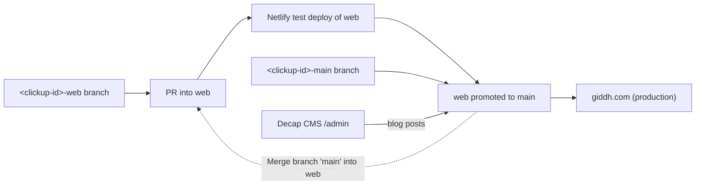

# Development & Verification Guide

How to install, run, build and check this repo, plus the env vars and the branch-to-production flow. Every command below was run on 2026-10-24 (Node v25.9.0, npm 11.12.1). For step-by-step change recipes see [RECIPES.md](RECIPES.md). For the system model see [ARCHITECTURE.md](ARCHITECTURE.md).

## Prerequisites & Runtime Environment

- **Node.js:** `>=20.9.0`. That floor comes from Next 16.4.3's own `engines` field (`node_modules/next/package.json`). The repo pins nothing: there is no `engines` in `package.json`, no `.nvmrc` and no `netlify.toml`. Local checks used v25.9.0. <!-- verify:ignore -->
- **Package manager:** npm, the only one the `package.json` scripts imply. There is **no committed lockfile**, because `.gitignore` lists `package-lock.json` (rationale in [DECISIONS.md ADR-012](DECISIONS.md#adr-012-web-staging-branch-no-committed-env-or-lockfile)).
- **System tools:** git. Nothing else: there is no Docker and no database.

> [!TODO]
> The Node version Netlify builds with isn't in the repo (no `netlify.toml`, `.nvmrc` or `engines`). It's set in the Netlify UI or falls back to Netlify's default. Needs a human to confirm and ideally pin it. <!-- verify:ignore -->

> [!WARNING]
> Installs aren't reproducible. Each `npm install`, locally and on Netlify, resolves the `^` ranges in `package.json` fresh, so a new minor of `next`, `sass` or `react` can change the build without any commit. Do not commit a `package-lock.json` as a side effect of your change. `.gitignore` excludes it, and changing that is a team decision.

## Step-by-Step Setup

1. **Clone & install:**
   ```bash
   git checkout web && git pull
   npm install            # ~202 packages, no lockfile is written to git
   ```
2. **Environment configuration:** there is no `.env.example` and no `.env` in the repo. `.gitignore` ignores `.env`, `.env.local`, `.env.production` and `.env.test`. To exercise API-backed pages, create `.env.local` yourself with the names from [Environment Variables Reference](#environment-variables-reference). Ask a human for non-production values. Never put production values in a file you might commit. <!-- verify:ignore -->
   ```bash
   touch .env.local   # fill with NEXT_PUBLIC_* names from the table below
   ```
3. **Start the dev server:**
   ```bash
   npm run dev        # next dev -p 8080
   ```
   Open `http://localhost:8080`. Locale variants live at `/in`, `/ae` and `/uk`.

Without any env vars the site still builds and renders, with these known degradations (baseline, 2026-10-24):
- Canonical tags render as `undefined/...` (for example `undefined/in`).
- The `/pricing` plan fetch goes to `undefined/v2/subscription/plans/all`, gets a 404, and the plan table stays empty.
- Login, signup and OTP calls go to relative `undefined/...` URLs.
- The CookieYes banner logs errors on localhost. CookieYes isn't referenced in repo code. *Inference:* it loads through GTM `GTM-K2L9QG` in `src/pages/_document.js`.

## Environment Variables Reference

The same eleven names, plus every hard-coded setting, are in [CONFIGURATION.md](CONFIGURATION.md). This table stays here because `scripts/vendor/ai-docs/verify_docs.py` requires each env var the code reads to appear in this file.

> [!WARNING]
> Every variable the code reads is `NEXT_PUBLIC_*`. Next inlines each one into the **client JS bundle at build time**, so anyone can read it in the browser. Never put a real secret in a `NEXT_PUBLIC_` var. `NEXT_PUBLIC_MSG91_AUTH_KEY` is sent as a `tokenAuth` header from the browser today (`src/utils/segmento.js:sendDataInSegmento`). It's client-exposed by design, but whether that key is scoped safely is open ([OPEN_QUESTIONS.md](OPEN_QUESTIONS.md)). Because values are inlined at build, changing one on Netlify needs a **rebuild**, not just a redeploy of the old build. <!-- verify:ignore -->

All 11 variables are client-exposed. No variable has a server-only reader. "Required" means a core path breaks without it.

| Var | Required | Default | Read in | Purpose / effect if missing |
|---|---|---|---|---|
| **Core URLs** | | | | |
| `NEXT_PUBLIC_SITE_URL` | yes | `https://giddh.com`, but only in `src/pages/_app.js:MyApp` (`path.baseURL`) | `src/components/header.js:Header` (canonical, `og:image`), `src/pages/blog/[slug].js:BlogPage` (`og:image`), `src/utils/getBlogSchema.js:getBlogSchema` and `generateBlogSchema`, `src/components/googleLogin.js` (redirect URI), `src/pages/v2/login.js` | Public origin of the site. Only `path.baseURL` (the navbar country switcher in `src/components/navbar.js`) has a fallback. Everywhere else, unset renders `undefined/...` canonicals and OG images. The hand-written entries in `src/data/blogSchema.json` are matched by `${NEXT_PUBLIC_SITE_URL}/blog/<slug>` against URLs written as `https://giddh.com/blog/...`, so any other value silently falls back to the generated schema. |
| `NEXT_PUBLIC_API_URL` | yes | — | `src/pages/signup.js`, `src/pages/login.js`, `src/pages/v2/login.js`, `src/pages/chartered-accountant-signup.js`, `src/components/otpVerifyModal.js`, `src/pages/pricing.js`, `src/pages/payment.js`, `src/utils/affiliateRegistration.js:AFFILIATE_REGISTER_URL` | Giddh API base URL for every non-UK call. Unset → requests hit `undefined/...` on the site's own origin and return 404: no pricing plans, login, signup, OTP, invoice payment or affiliate registration. Endpoints are in [CONTRACTS.md](CONTRACTS.md). |
| `NEXT_PUBLIC_UK_API_URL` | yes for `/uk` | — | the same auth files as above, used when `path.isUK` | Giddh API base for UK-region auth (register, OTP, login). `pricing.js`, `payment.js` and `affiliateRegistration.js` always use `NEXT_PUBLIC_API_URL`, even on `/uk`. |
| `NEXT_PUBLIC_APP_URL` | yes | — | `src/utils/signupHelpers.js:handleOtpVerifyRedirect`, `src/pages/signup.js`, `src/pages/login.js`, `src/pages/v2/login.js`, `src/pages/chartered-accountant-signup.js` | The Giddh web app that users are sent to after login or signup (`/token-verify?...`). Unset → the browser navigates to a relative `undefined/token-verify...` and gets a 404. |
| `NEXT_PUBLIC_APP_ENV` | no | — | `src/utils/s3Config.js:getEnvName` | Path segment in desktop-app download URLs. The value `test` switches the installer name to `giddh-test-setup`. Unset → the URL contains `/undefined/`. |
| **Auth** | | | | |
| `NEXT_PUBLIC_GOOGLE_CLIENT_ID` | yes for Google login | — | `src/components/googleLogin.js` | Google OAuth client ID for the implicit-flow popup. Unset → the popup opens with `client_id=undefined` and Google shows an error. |
| **Payments** | | | | |
| `NEXT_PUBLIC_RAZORPAY_KEY` | yes for `/payment` | — | `src/pages/payment.js` (`payInvoice`) | Razorpay checkout key for paying a Giddh invoice. *Inference:* this must be the publishable key ID. The Razorpay key secret must never go in a `NEXT_PUBLIC_` var. | <!-- verify:ignore -->
| **Lead capture** | | | | |
| `NEXT_PUBLIC_MSG91_PHONEBOOK_URL` | yes for demo form | — | `src/utils/segmento.js:sendDataInSegmento` | MSG91 Segmento phonebook endpoint for book-a-demo leads (`src/components/NewComps/BookFreeDemoForm/index.js`). Unset → the fetch fails, the error is caught, and the function returns `{status: "error"}`. |
| `NEXT_PUBLIC_MSG91_AUTH_KEY` | yes for demo form | — | `src/utils/segmento.js:sendDataInSegmento` | Sent as the `tokenAuth` header from the browser. See the warning above. |
| **Desktop downloads** | | | | |
| `NEXT_PUBLIC_S3_BASE_URL` | no | — | `src/utils/s3Config.js:getS3BaseUrl` | Base URL for installer downloads (`src/components/downloadFreeModal.js`, `src/components/footer.js`). Unset → `getDownloadUrl` returns `""` and `getAppVersion` shows `latest`. |
| `NEXT_PUBLIC_S3_BUCKET_NAME` | no | — | `src/utils/s3Config.js:getBucketName` | Bucket path segment. Same fallback as `NEXT_PUBLIC_S3_BASE_URL`. |

Read env vars as the literal `process.env.NEXT_PUBLIC_X`. Next only inlines literal property access, so `process.env[name]` is `undefined` in the browser. <!-- verify:ignore -->

> [!TODO]
> Where the values live isn't recorded in the repo. *Inference:* they're set in the Netlify site environment, with different values for the `web` test site and the `main` production site. `.env.production` was tracked until PR #536 (see ADR-012). Needs a human to confirm where the values are kept and who can change them. <!-- verify:ignore -->

### Must match other services
- `${NEXT_PUBLIC_SITE_URL}/googleauth` must be a registered redirect URI for `NEXT_PUBLIC_GOOGLE_CLIENT_ID` in Google Cloud. The page that receives it is `src/pages/googleauth.js`. A mismatch breaks Google login only on that host.
- `NEXT_PUBLIC_API_URL` / `NEXT_PUBLIC_UK_API_URL` and `NEXT_PUBLIC_APP_URL` must point at the same environment. *Inference:* the app's `/token-verify` has to accept the session IDs the API issued.
- hreflang links in `src/components/header.js:Header` hard-code `https://giddh.com`, while canonicals use `NEXT_PUBLIC_SITE_URL`. On any other host the two disagree.

## Build & Preview Verification

```bash
npm run build      # next build (Turbopack); ~402 prerendered pages
npm run start      # next start -p 8080, serves the production build
```
Expected build output:
- 402 static pages.
- One Sass deprecation warning: `map-has-key` in `src/scss/mixins.scss` (pre-existing; ignore it, but don't add new ones).
- Locally, possibly a warning about a `package-lock.json` outside the repo (machine-specific).

Not every route is static: `/blog` and `/blog/tags/[[...slug]]` use `getServerSideProps` (`src/pages/blog/index.js`, `src/pages/blog/tags/[[...slug]].js`), so the deploy needs the Next runtime, not a static export.

`next.config.js` sets three things: Sass `silenceDeprecations: ['import']`, an explicit `turbopack: {}`, and a webpack `fs: false` fallback that Turbopack builds don't use. Path alias `@/*` → `src/*` comes from `jsconfig.json`. <!-- verify:ignore -->

## Running Automated Checks & Tests

| Check Suite | Command | What It Validates |
|---|---|---|
| Type Checking | none | JS only, no TypeScript or `tsconfig.json`. `next build` prints "Running TypeScript" but checks nothing. | <!-- verify:ignore -->
| Linting & Formatting | `npm run lint` is **broken** | It runs `next lint`, which Next 16 removed. It fails with "Invalid project directory provided, no such directory: .../lint". There's no ESLint config either. `.prettierrc` sets only `singleQuote: false`, and Prettier isn't a dependency, so formatting is editor-only. Don't treat lint as a check. |
| Unit / Component Tests | none | No test runner or test files. |
| End-to-End Tests | none | No Playwright or Cypress. |

The only automated gate is `npm run build`, run by you and by Netlify. There's no CI workflow: no `.github/workflows/` or similar. <!-- verify:ignore -->

> [!WARNING]
> Don't reformat files you aren't changing. The codebase mixes 2- and 4-space indentation, and a whole-file reformat buries your real change. It also makes the before/after HTML comparison below harder to read.

## Safe Test-Data Guidance

Every form on the site talks to **real backends**:
- Signup, login and OTP: the Giddh API at `NEXT_PUBLIC_API_URL` / `NEXT_PUBLIC_UK_API_URL`.
- Invoice payment: Razorpay checkout on `/payment`.
- Book-a-demo leads: the MSG91 Segmento phonebook.
- Affiliate registration: `/verify-and-send`.
- Analytics: GTM and the amplifyapp tracker in `src/pages/_document.js`.

- **Never submit a real form from an agent against production values.** It creates real users, sends real OTP SMS and email, creates CRM leads, or takes payment.
- Without env vars these calls fail harmlessly (relative `undefined/...` URLs), which is the safe default for UI-only work.
- For UI checks of forms, stop at filling fields and checking validation. Don't click the final submit, send-OTP or pay buttons.
- Treat the analytics scripts as live even on localhost. Avoid scripted mass page views.

> [!TODO]
> No sandbox or test configuration exists in the repo: no test API URL, test Razorpay key, mock handlers or seeded test accounts. Needs a human to say which non-production API, app and Razorpay test values are safe to use locally and on the `web` test site.

## How an Agent Checks Its Work (Verification Checklist)

1. **Pre-flight baseline:** run `npm install && npm run build` on the untouched branch and keep the result (page count, warnings). Capture the prerendered HTML if you're refactoring (step 3).
2. **Build after the change:** `npm run build` must pass with the same page count, or the count plus the pages you deliberately added. The only warning should be the existing `mixins.scss` one. An MDX error in any post fails the whole build (`src/pages/blog/[slug].js:getStaticProps` throws on a missing slug).
3. **Refactors must produce identical HTML.** This is how the 2026-10 cleanup was verified (0 of 402 files differed; see [DECISIONS.md ADR-013](DECISIONS.md#adr-013-ai-readiness-prep-docs-set-and-evidence-based-cleanup)):
   ```bash
   # before the change (after `npm run build`)
   mkdir -p /tmp/html-before && (cd .next/server/pages && find . -name '*.html' | cpio -pdm /tmp/html-before)
   # make the change, `npm run build`, copy to /tmp/html-after the same way, then:
   diff <(cd /tmp/html-before && find . -name '*.html' | sort) <(cd /tmp/html-after && find . -name '*.html' | sort)
   norm() { sed -E 's#/_next/static/[^"'"'"' ]+#/_next/static/X#g; s#"buildId":"[^"]+"#"buildId":"X"#g; s#static/chunks/[a-z0-9_~.-]+\.(js|css)#static/chunks/X#g; s#"runtimeModuleIds":\[[0-9,]*\]#R#g' "$1"; }
   for f in $(cd /tmp/html-before && find . -name '*.html'); do
     cmp -s <(norm /tmp/html-before/$f) <(norm /tmp/html-after/$f) || echo "differs: $f"
   done
   ```
   Chunk hashes and `buildId` always change, which is why the script normalises them. Any other difference is a behaviour change you must explain. The SSR-only routes `/blog` and `/blog/tags/...` aren't in `.next/server/pages/**/*.html`, so check them in the browser. <!-- verify:ignore -->
4. **Browser check:** run `npm run start`, open every page you touched **and its locale variants** (`/x`, `/in/x`, `/ae/x`, `/uk/x` where they exist), and check:
   - the page renders with no new console errors (ignore the env-related noise listed under setup)
   - `<title>` and `meta description` come from `src/data/metadata.json` (key = exact path)
   - the canonical, where the metadata defines one
   - the `hreflang` alternates, which come from `src/data/hrefLangTag.json`
   - the JSON-LD (`<script type="application/ld+json">` from `src/components/NewComps/Schema`)
   - mobile (375px) and desktop widths

   Rules for each tag are in [DESIGN.md](DESIGN.md).
5. **URLs:** if you renamed or removed a URL, add a `301` in `public/_redirects` (see [RECIPES.md](RECIPES.md#rename-or-remove-a-url)). A missing redirect has happened before: `ca-signup` (see [DECISIONS.md](DECISIONS.md#lessons-learned--incident-log)).
6. **New pages** need entries in `src/data/metadata.json` and `src/data/hrefLangTag.json`, plus `public/sitemap.xml` (see [RECIPES.md](RECIPES.md)).
7. **Docs in the same change:** update the owning `docs/*.md` (env vars here and in [CONFIGURATION.md](CONFIGURATION.md), endpoints in [CONTRACTS.md](CONTRACTS.md), flows in [FLOWS.md](FLOWS.md), components in [DESIGN.md](DESIGN.md)), then run the doc verifier with `--docs <changed docs>` and get 0 errors.

## PR Workflow & Deployment Pipeline

### Promotion Pipeline: `<clickup-id>-web` → `web` (Netlify test) → `main` (Production, giddh.com)



### Flow Steps
1. **Branch creation:** branch from `web`, named after the ClickUp task: `git checkout -b <clickup-id>-web web`. Recent examples: PRs #816–#824 and #827, all from `86d4ab4uh-web`.
2. **Pre-PR self-verification:** complete the checklist above. Keep `git status` clean: no lockfile, no `.env*`, no `.next/`. <!-- verify:ignore -->
3. **Pull request:** open it against `web`. Commit and PR titles in history are free-form, often `Name | area | summary`. No conventional-commit rule is enforced.
4. **Test environment (`web`):** Netlify deploys `web` to a test site. That's the only pre-production check, since there's no CI.
5. **Production (`main`):** `web` is promoted to `main`. *Inference:* Netlify builds `main` for giddh.com.
6. **Hotfixes:** `<clickup-id>-main` branches merge straight into `main`, for example PR #825 from `86d4cfrzf-main`. `main` is then merged back into `web`, as the "Merge branch 'main' of …Giddh-Website into web" commits (`7db9e002`, `fada178f`) or a PR of the same `-main` branch into `web` (PR #826, `e91e4f63`) show.
7. **Blog posts from Decap CMS:** `public/admin/config.yml` uses `backend: git-gateway`, `branch: main` and `publish_mode: editorial_workflow`. Posts edited at `/admin` (behind Netlify Identity, `public/admin/index.html`) are committed to **`main` first**. They reach `web` only when `main` is merged back.

> [!WARNING]
> `web` and `main` have diverged. `web` is 142 commits ahead of `main`. The last `web` → `main` PR in history is #737 (`b7eb090b`, 2026-02-25), and most later `main` changes came through `<id>-main` branches. Some features merged into `web` are not on production. For example, `66a7f148` (`src/pages/triggers.js` and related pages) is not an ancestor of `origin/main`. Before assuming production matches `web`, check with `git merge-base --is-ancestor <sha> origin/main`.

> [!TODO]
> The approval rules, who promotes `web` → `main`, and how often aren't in the repo (no CODEOWNERS, no branch protection config). The Netlify site names and URLs of the test and production deploys also need a human.

### Netlify files in `public/`
- `public/_redirects`: about 2,000 Netlify rules, all `<from> <to> 301`. Netlify uses the first matching rule, and 6 source paths already appear twice (for example `/blog/which-accounting-software-is-best-in-india-for-gst`). Some sources are full URLs like `http://shopify.giddh.com/*`. The file has **no trailing newline**, so `echo ... >> public/_redirects` glues your rule onto the last line. Edit it with an editor, or add a newline first.
- `public/_headers`: `X-Frame-Options: DENY` and `Content-Security-Policy: frame-ancestors 'none'` on `/*`. The reason for doing this in Netlify rather than `next.config.js` is in [DECISIONS.md ADR-004](DECISIONS.md#adr-004-anti-framing-headers-in-netlify-_headers). It means the site can't be iframed anywhere.
- `public/admin/`: the Decap CMS UI (`index.html` loads `netlify-cms@^2.0.0` from unpkg plus the Netlify Identity widget) and `config.yml`. It's served at `/admin` and marked `noindex`.

Root `config.js` holds only `posts_per_page` (25), read through `src/components/blogs/lib/config.js` by `src/pages/blog/index.js`, `src/pages/blog/page/[page].js` and `src/pages/blog/tags/[[...slug]].js`. Its blog-template leftovers (`base_url`, `site_title`, …) were removed in `207fbc59`. Site URLs come from env vars, not this file. <!-- verify:ignore -->
