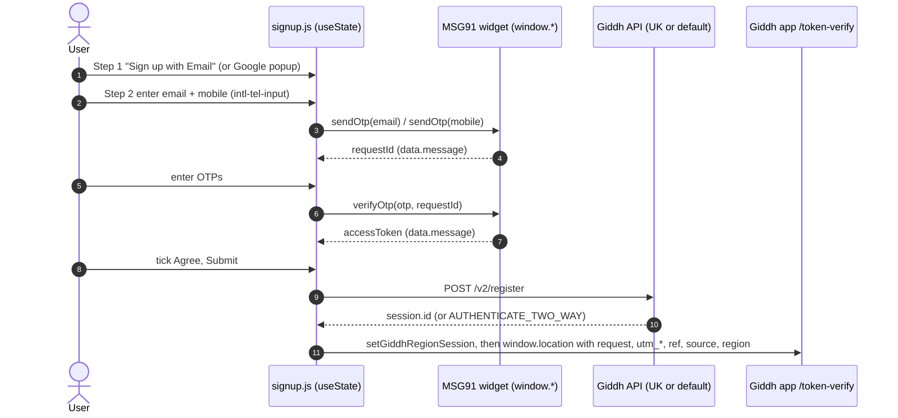
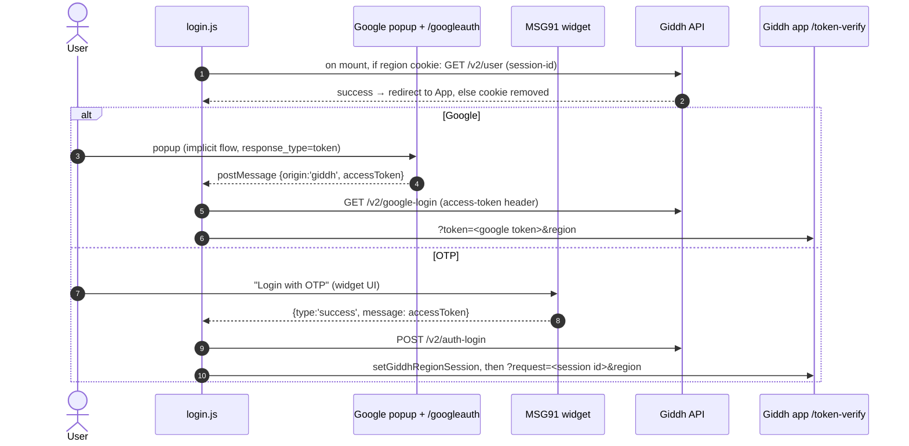
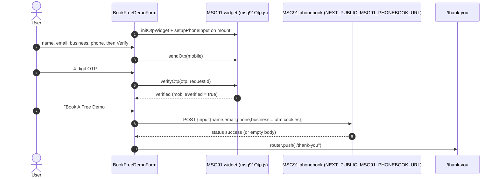

# User Flows & Critical Journeys

Every interactive flow on the site is a funnel step that ends in a full-page redirect: to the Giddh app (`NEXT_PUBLIC_APP_URL` + `/token-verify`) for signup and login, or to `/thank-you` for the demo form. There is no client store, no route guard and no shared API client. Each page holds its state in `useState`, calls `fetch` directly, and reports errors with react-toastify toasts. Endpoint shapes live in [CONTRACTS.md](CONTRACTS.md). The module map and the `path` / `pageData` pipeline live in [ARCHITECTURE.md](ARCHITECTURE.md). Env vars, the hard-coded MSG91 widget credentials, and cookie names live in [CONFIGURATION.md](CONFIGURATION.md). Product intent lives in [VISION.md](VISION.md).

Rechecked at `fa3d74c4`: the API base switch and the chrome-hiding slug list match the shared plumbing below. `src/components/otpVerifyModal.js` still reads `props.path.isUK`, while `src/pages/signup.js` and `src/pages/login.js` still pass their whole props object as `path`. `src/pages/chartered-accountant-signup.js` destructures `{ path }`, so only that page passes the object the modal expects.

Shared plumbing every flow below relies on:

- **`public/js/helper.js` globals.** This is a classic script loaded synchronously from `src/pages/_document.js`. Pages call its functions **without importing them**: `setGiddhRegion`, `setGiddhRegionSession`, `getRegionSessionCookieName`, `getCookie`, `getLocalStorage`, `addOtpWidgetScript`, `getOtpwidgetConfiguration`, `getCurrentSiteCountryUrl`, `openCalendly`. On every page load it also runs `setUtmParamInLocalStorage` (localStorage `utm_*`, `ref`, `region`, `source`, plus cookie `giddh_query`) and `setUtmParamsInCookies` (cookies `utm_*`, `ref`, `region`, `gclid`, `fbclid`).
- **Session cookie.** `public/js/helper.js:setGiddhRegionSession` writes `giddh_session_id_uk` for region UK and `giddh_session_id` for everything else (GL, IN, AE). The cookie lasts 30 days and is scoped to `.giddh.com` on production hosts (`setCookie`).
- **API base switch.** `isUK ? NEXT_PUBLIC_UK_API_URL : NEXT_PUBLIC_API_URL` appears in signup, CA signup, both login pages and `src/components/otpVerifyModal.js`. Pricing, payment and the affiliate form always use `NEXT_PUBLIC_API_URL`.
- **Region code.** It comes from `path.linkPrefix` (`/in` → `IN`, empty → `GL`). It is sent as `&region=` to `/token-verify` and stored in the `giddh_region` cookie.
- **MSG91 OTP widget.** `public/js/helper.js:addOtpWidgetScript` injects the MSG91 otp-provider.js script from verify.msg91.com. That exposes `window.sendOtp`, `window.verifyOtp`, `window.retryOtp` and `window.getWidgetData`. The widget id and token are hard-coded in `getOtpwidgetConfiguration` (the same for every environment), so every OTP test sends a real SMS or email.
- **Chrome.** `src/pages/_app.js` hides Navbar and Footer when the last path segment is `login`, `signup`, `chartered-accountant-signup`, `online-accounting-software`, `thank-you` or `googleauth`.

## Core User Journeys Map

| Flow Name | Trigger / Starting Route | Target Outcome | Primary Route & Component |
|---|---|---|---|
| Signup (incl. locale variants) | `/signup`, `/in/signup`, `/ae/signup`, `/uk/signup` | Account created, user lands in the Giddh app | `src/pages/signup.js:initiateSignup` |
| CA (ICAI) signup | `/chartered-accountant-signup` (global only) | CA account created with MRN attached to `source` | `src/pages/chartered-accountant-signup.js:CharteredAccountantSignup` |
| Login | `/login` (+ locale variants), `/v2/login` | Session validated, redirect to the app | `src/pages/login.js`, `src/pages/v2/login.js` |
| Book a free demo | `/online-accounting-software` banner form | Lead stored in MSG91 phonebook, `/thank-you` shown | `src/components/NewComps/BookFreeDemoForm/index.js:BookFreeDemoForm` |
| Pricing | `/pricing` (+ locale variants) | Visitor picks a plan → `/signup` or Calendly | `src/pages/pricing.js` |
| Invoice payment | `/payment?token=…&voucherVersion=1\|2` (link from a Giddh invoice) | Razorpay payment recorded on the invoice | `src/pages/payment.js:payInvoice` |
| Affiliate registration | `/affiliate` (+ locale variants) | Affiliate request submitted (toast, no redirect) | `src/components/NewComps/AffiliateForm/index.js:AffiliateForm` |
| Blog reading | `/blog`, `/blog/tags/<tag>`, `/blog/<slug>` | Post read | `src/pages/blog/[slug].js` |
| Locale switch | Navbar country dropdown | Locale home page | `src/components/navbar.js` |

> [!NOTE]
> `/pricing` never links to `/payment`. Plan CTAs go to `link + "/signup"`, and "Talk to sales" calls `openCalendly()`. `/payment` is a separate journey: invoice pay links for customers of Giddh users.

---

## Detailed Journey: Signup (`/signup`, locale variants, CA signup)

### 1. Happy Path Sequence

### 2. Step-by-Step Path & Code Connections

1. **User Action & Route:**
   - URL: `/signup`. `src/pages/in/signup.js`, `src/pages/ae/signup.js` and `src/pages/uk/signup.js` are wrappers that render `src/pages/signup.js` with `path`.
   - Entry Component: default export of `src/pages/signup.js`. On mount it calls `setGiddhRegion` and `initOtpSignup`, which loads the MSG91 widget and, after 2 s, reads resend channels via `src/utils/signupHelpers.js:getWidgetChannels`.
   - Trigger: step 1 offers `src/components/googleLogin.js` or "Sign up with Email" (`resetEverything` → step 2). Step 2 calls `loadTelLibrary`, which attaches intl-tel-input 18.1.1 from jsDelivr with `initialCountry: "auto"` and `geoIpLookupHandler`.
2. **State & Validation:**
   - `emailDetails` / `mobileDetails` hold `{ email|mobileNo, accessToken, isVerified, signupVia, requestId }`. Email is checked with an inline regex in `sendEmailOtp`. The mobile number is `intl.getNumber()` with `+` stripped (`src/utils/signupHelpers.js:formatMobileNumber`).
   - OTP boxes are DOM inputs (`.email-otp-field`, `.mobile-otp-field`), wired by `src/utils/signupHelpers.js:initiateOtpFieldsAutoMove` and read by `getOtpFromFields`.
   - Submit is disabled until `termsAgree`. `initiateSignup` requires both `isVerified` flags. If neither is verified and both inputs are filled, it sends the email OTP, then the mobile OTP 3 s later.
3. **API Dispatch:**
   - `POST /v2/register` with email, email access token, `emailIdAuthType` (`giddh` or `google`), mobile and mobile access token. The body shape is in [CONTRACTS.md](CONTRACTS.md).
   - Google signup: `googleApiSuccessCallback` stores the Google access token as `emailDetails.accessToken` with `signupVia: "google"`, so only the mobile OTP is needed.
4. **Response & Persistence:**
   - Success: `setGiddhRegionSession(session.id, region)`, then redirect to `NEXT_PUBLIC_APP_URL/token-verify?request=<id>&utm_source…&ref=…&source=<getSourceParam()>&region=<REGION>`. The UTM values are read from **localStorage**.
   - `statusCode === "AUTHENTICATE_TWO_WAY"`: opens `src/components/otpVerifyModal.js`. That posts `/v2/verify-number` (resend: `/generate-otp`), then `src/utils/signupHelpers.js:handleOtpVerifyRedirect`. This redirect **drops the UTM and source params**.

### 3. Alternative Paths & Conditional Branches

- **Branch A (UK locale):** `isUK` switches the API base to `NEXT_PUBLIC_UK_API_URL`, and the session cookie becomes `giddh_session_id_uk`.
- **Branch B (CA signup, `/chartered-accountant-signup`):** this page is a copy of signup.js with `typeof` / `?.` guards. It adds a required MRN field (`mrnNumber`). The MRN is **not** sent to `/v2/register`. `getCaSourceParam` merges it into the `source` JSON of the redirect and persists it to localStorage `source` and cookie `giddh_query`. Phone input uses `initialCountry: "in"` (no geo-IP). The region is always `GL` because there are no locale variants. This page renders its own marketing sections (`Stats`, NewComps `Footer`).
- **Branch C (`userData` in localStorage):** `initOtpSignup` pre-fills a verified email or mobile from `getLocalStorage("userData")`. Nothing in this repo writes that key. It is probably dead, because the app is a different origin (inferred).

### 4. Permissions, Roles & Guard Rails

- **Required Role / Permission:** none. Anonymous visitors can sign up. "Verified" exists only as the client flags described above. The API re-checks the MSG91 or Google access tokens (assumed; the server is outside this repo).
- **Enforcement Location:** `initiateSignup` checks the flags, and the Submit `disabled={signupInProgress || !termsAgree}`.
- **Unauthorized Behavior:** a toast ("Please verify email" or "Please verify mobile").

### 5. Failure Modes & Recovery Paths

| Failure Scenario | Where Caught | UI Feedback | Recovery / Fallback Action |
|---|---|---|---|
| OTP send/verify fails | widget error callbacks (`emailOtpFailedCallback`, `verifyOtpErrorCallback`) | Toast with widget `error.message` | Resend per channel (`retrySendOtp`, channel 3 = email) |
| `/v2/register` returns `status != success` | `.then` in `initiateSignup` | Toast `response.message` | Spinner reset, user can resubmit |
| Network error | `.catch` → `src/utils/signupHelpers.js:handleSignupError` | Toast of the raw Error object | Spinner reset |
| Google signup then Submit before a mobile OTP | none (`mobileDetails` is `null`) | Nothing: TypeError in the handler | Reload. The CA page is guarded with `?.` |
| Geo-IP lookup | `src/utils/signupHelpers.js:geoIpLookupHandler` | Country always "in" | See Known defects |

---

## Detailed Journey: Login (`/login`, `/v2/login`, `/googleauth`)

### 1. Happy Path Sequence

### 2. Step-by-Step Path & Code Connections

1. **User Action & Route:**
   - URL: `/login`. `src/pages/in/login.js`, `src/pages/ae/login.js` and `src/pages/uk/login.js` wrap `src/pages/login.js`.
   - Entry: `src/pages/login.js` renders `src/components/googleLogin.js`, `src/components/otpLogin.js` and a lazily loaded `src/components/otpVerifyModal.js`.
2. **State & Validation:**
   - `useEffect` → `setGiddhRegion` and `validateUserSession(getCookie(getRegionSessionCookieName(region)))`.
   - The OTP login uses the widget in non-exposed mode (`addOtpWidgetScript(false, initiateLogin, false)`). MSG91 renders its own UI and calls back with an access token.
3. **API Dispatch:** `GET /v2/user`, `GET /v2/google-login`, `POST /v2/auth-login` (see [CONTRACTS.md](CONTRACTS.md)).
4. **Response & Persistence:** the session id goes into the region cookie, then the browser goes to `/token-verify`. Google login sends `?token=<Google access token>`, not a Giddh session id.

### 3. Alternative Paths & Conditional Branches

- **Branch A (two-way auth):** `statusCode === "AUTHENTICATE_TWO_WAY"` opens `src/components/otpVerifyModal.js`. That runs `POST /v2/verify-number` (resend: `POST /generate-otp`) → `otpVerifyCallback` → redirect.
- **Branch B (`/v2/login`, Q-006 in [OPEN_QUESTIONS.md](OPEN_QUESTIONS.md)):** this page has the same code plus "Login with password". `src/components/loginWithPassword.js` opens a Bootstrap modal and calls `initiateEmailPasswordLogin` → `POST /v2/login-with-password` with `{ uniqueKey, password }`. It differs from `/login` in four ways:
  - It never calls `setGiddhRegion`.
  - It omits `&region=` from every redirect.
  - Its region parses as `V2`, because `src/pages/_app.js` treats `/v2` as a 3-character prefix. `getRegionSessionCookieName` maps that to the IN cookie.
  - The logo link comes from `getCurrentSiteCountryUrl`.
  It gets `noindex` only from a client effect in `src/components/header.js`. The old URL `/v2/login-with-password` 301s to `/v2/login` (`public/_redirects`).
- **Branch C (`/googleauth`):** `src/pages/googleauth.js` is the OAuth redirect target (`NEXT_PUBLIC_SITE_URL/googleauth`, client `NEXT_PUBLIC_GOOGLE_CLIENT_ID`). It parses `access_token` from the hash, posts it to `window.opener` and closes itself. `src/components/googleLogin.js:getGoogleUserDetails` then calls Google userinfo and hands `{ email, accessToken, … }` to the page. Signup uses the same component.

### 4. Permissions, Roles & Guard Rails

- **Required Role / Permission:** none on the site. The only automatic branch is the existing-session redirect on mount.
- **Enforcement Location:** `validateUserSession` in both login pages. An invalid session triggers `removeGiddhRegionSession(region)`.
- **Unauthorized Behavior:** the user stays on the login page and sees a toast with the API `message`.

### 5. Failure Modes & Recovery Paths

| Failure Scenario | Where Caught | UI Feedback | Recovery / Fallback Action |
|---|---|---|---|
| Stale session cookie | `validateUserSession` | none | Cookie deleted, login form stays |
| `/v2/user` network error | not caught (no `.catch`) | none | Login form usable |
| Google/OTP/password login rejected | `.then` branches | Toast `response.message` | Retry |
| Network error on login calls | `.catch((err) => showToaster(err, "error"))` | Toast of raw Error | Retry. The OTP spinner stays on (`authLoginInProgress` not reset) |
| UK user hits two-way auth | `src/components/otpVerifyModal.js` (`props.path.isUK`) | Wrong-region error from API | None. See Known defects #2 |
| `/googleauth` opened without opener | `src/pages/googleauth.js` | Page stuck on "Loading..." (TypeError) | None |

> [!WARNING]
> `src/pages/googleauth.js` posts the Google access token with targetOrigin `"*"`. The listener in `src/components/googleLogin.js` checks only `event.data.origin === "giddh"`, never `event.origin`, and is never removed. Tighten both together. Netlify deploy previews also need their `/googleauth` URI registered with Google, or Google login fails there.

---

## Detailed Journey: Book a Free Demo

### 1. Happy Path Sequence

### 2. Step-by-Step Path & Code Connections

1. **User Action & Route:** `src/components/NewComps/Banner/SplitBanner/index.js` renders the form only when `compData.form` is true. Today that is only `src/data/pagesdata/global/online-accounting-software.json`, the global landing page with Navbar and Footer hidden. Fields: `src/components/NewComps/BookFreeDemoForm/FormFields.js` and `PhoneField.js`.
2. **State & Validation:** `formData` holds `{ name, email, phone, business }`, plus `mobileVerified`, `requestId` and a 4-slot `otp` array (`handleOtpChange` handles paste). The phone input comes from `src/utils/phoneInput.js:setupPhoneInput` (`initialCountry: "in"`) and is validated by `intl.isValidNumber()`. The widget loads via `src/utils/msg91Otp.js:initOtpWidget`, and resend channels come from `getResendChannels`.
3. **API Dispatch:** `src/utils/segmento.js:sendDataInSegmento` → `POST NEXT_PUBLIC_MSG91_PHONEBOOK_URL` with header `tokenAuth: NEXT_PUBLIC_MSG91_AUTH_KEY`. UTM values come from **cookies** via `src/utils/utmParams.js:getUtmParamsFromCookies`. Shape: [CONTRACTS.md](CONTRACTS.md).
4. **Response & Persistence:** `status === "success"` (or an empty body) resets the form and pushes `/thank-you`. `src/pages/thank-you.js` renders `src/components/NewComps/ThankYou/index.js`, which has demo-specific copy. Nothing is stored locally.

### 3. Alternative Paths & Conditional Branches

- **Branch A (Change number):** `resetMobileVerification` clears the phone, OTP and verified flag.
- **Branch B (widget not loaded):** `waitForOtpService` rejects with "OTP service is unavailable…".
- **Branch C (other "demo" CTAs):** pricing's "Talk to sales" and other buttons call `openCalendly()` (a Calendly popup in `public/js/helper.js`). They don't use this form.

### 4. Permissions, Roles & Guard Rails

- **Required Role / Permission:** anonymous. Submit is disabled until `mobileVerified`.
- **Enforcement Location:** client only. No MSG91 access token is forwarded with the lead, so the phonebook cannot tell that the phone was verified.
- **Unauthorized Behavior:** inline "Please verify your mobile number" plus a toast.

### 5. Failure Modes & Recovery Paths

| Failure Scenario | Where Caught | UI Feedback | Recovery / Fallback Action |
|---|---|---|---|
| Invalid phone | `isValidMobile` | Toast | Fix the number |
| OTP send/verify error | widget callbacks | Toast. The OTP boxes clear on verify failure | Resend via channel buttons |
| Phonebook returns non-success | `handleSubmit` | Inline "Error submitting form: {errors}". May render an object | Resubmit |
| Network error | `sendDataInSegmento` returns `{status:"error"}` | Inline error | Resubmit |

> [!WARNING]
> `NEXT_PUBLIC_MSG91_AUTH_KEY` is an MSG91 auth key, and the NEXT_PUBLIC_ prefix ships it in the client bundle. Treat it as public. Don't reuse it for anything privileged.

---

## Detailed Journey: Pricing and Invoice Payment

### 1. Happy Path Sequence

- **Pricing:** on mount → `GET /v2/subscription/plans/all?regionCode=` with `IND`, `ARE`, `GBR` or `GLB`, chosen by `getRegionByLink`. Plans are sorted by `yearlyAmount` or `monthlyAmount` (`sortPlansByAmount`). Static per-locale copy comes from `src/data/pricingData.json`. A CTA goes to `/signup`.
- **Payment:** a Giddh invoice link opens `/payment?token=&voucherVersion=` → `GET /invoice-pay-request/<token>` → PDF embed plus "Pay Now" → Razorpay checkout → `successPayment` → `POST /company/<uniqueName>/invoices/<contentNumber>/pay?voucherVersion=` (proforma: `/proforma/<n>/pay`) → success toast, and `canPay` is set to false.

### 2. Step-by-Step Path & Code Connections

1. **User Action & Route:** `src/pages/pricing.js` has wrappers `src/pages/in/pricing.js` and `src/pages/ae/pricing.js`. `src/pages/uk/pricing.js` wraps `../in/pricing`. `src/pages/payment.js` is global only.
2. **State & Validation:**
   - Pricing: `allPlans`, `plans`, `isYearPlan` (Month/Year toggle) and `isLoading` (`src/components/customLoader.js`). Prices exist only after hydration (Q-003 in [OPEN_QUESTIONS.md](OPEN_QUESTIONS.md)).
   - Payment: query params are parsed by hand into `params`. "Pay Now" shows for v1 when `apiResponse.status != "paid"`, and for v2 when `body.canPay`.
3. **API Dispatch:** Razorpay options use key `NEXT_PUBLIC_RAZORPAY_KEY`. The amount is `body.amount` for v2 and `body.amount * 100` for v1. The currency is `body.currency.code` for v2 and `INR` for v1. No Razorpay order is created server-side first. The script loads via `next/script` from `checkout.razorpay.com`.
4. **Response & Persistence:** none client-side. The Giddh API records the payment.

### 3. Alternative Paths & Conditional Branches

- **Branch A (only one duration):** `showToggleButton` stays false when plans lack monthly or yearly amounts.
- **Branch B (discounts):** `getPricingMessage` returns "Free to N months" or "Save X for N months" (see Known defects #7).
- **Branch C (proforma):** `contentType === "proforma"` posts the raw Razorpay response.

### 4. Permissions, Roles & Guard Rails

- **Required Role / Permission:** pricing is public. Payment trusts possession of the `token`; there is no login.
- **Enforcement Location:** the Giddh API (`/invoice-pay-request/`).
- **Unauthorized Behavior:** toast "No payment request found!", and the page stays empty.

### 5. Failure Modes & Recovery Paths

| Failure Scenario | Where Caught | UI Feedback | Recovery / Fallback Action |
|---|---|---|---|
| Plans fetch fails | `try/catch` in pricing `fetchData` | Empty table, `console.error` | None (reload) |
| Pay request fetch network error | not caught | Loader spins forever | Reload |
| Razorpay script missing | empty `catch (exception) {}` in `payInvoice` | Nothing happens | Reload |
| v1 invoice paid in Razorpay | `successPayment` throws (`data` undefined) | Nothing. **Money is taken, Giddh not updated** | Manual reconciliation. See Known defects #1 |

---

## Detailed Journey: Affiliate Registration

### 1. Happy Path Sequence

`/affiliate` (all locales re-export `src/pages/affiliate.js`) → SplitBanner `affiliateForm: true` → `AffiliateForm`. The user enters a full name, then email → "Verify" (`sendEmailOtp`, MSG91 channel 3) → OTP (`verifyEmailOtp`) → optional company and phone → Submit → `POST NEXT_PUBLIC_API_URL/verify-and-send` → toast "You have registered successfully!" and the form resets.

### 2. Step-by-Step Path & Code Connections

1. **User Action & Route:** `src/components/NewComps/AffiliateForm/index.js:AffiliateForm`, mounted from `src/components/NewComps/Banner/SplitBanner/index.js`.
2. **State & Validation:**
   - `src/hooks/useEmailOtpVerification.js:useEmailOtpVerification` owns `emailDetails`, `showEmailOtp`, the progress flags, `retrySendOtp` and `changeEmail`. It polls for `window.sendOtp` (`waitForSendOtp`, 25 × 200 ms). OTP boxes are bound by `src/utils/bindOtpInputs.js:bindOtpInputs`.
   - `src/hooks/useIntlTelInput.js:useIntlTelInput` sets up the phone input (geo-IP via db-ip, fallback "in").
   - Full name is required. The phone is not validated.
3. **API Dispatch:** `src/utils/affiliateRegistration.js:submitAffiliateRegistration` sends `email`, `phone`, `full_name`, `company_name`, `website_url`, `currency_code` and `"access-token"` (the MSG91 email token). `getAffiliateRegionMeta` maps the locale to INR, AED or GBP, with USD for global. Shape: [CONTRACTS.md](CONTRACTS.md).
4. **Response & Persistence:** success shows a toast and resets. There is no redirect and nothing is stored.

### 3. Alternative Paths & Conditional Branches

- **Branch A (change email):** `changeEmail` clears verification and keeps the other fields.

### 4. Permissions, Roles & Guard Rails

- **Required Role / Permission:** anonymous with a verified email. The API receives the MSG91 access token to re-check it.
- **Enforcement Location:** `handleSubmit` checks `isEmailVerified`.
- **Unauthorized Behavior:** toast "Please verify email".

### 5. Failure Modes & Recovery Paths

| Failure Scenario | Where Caught | UI Feedback | Recovery / Fallback Action |
|---|---|---|---|
| Widget never loads | `waitForSendOtp` | Toast "OTP service is unavailable…" | Refresh |
| API error | `submitAffiliateRegistration` throws `apiMessage` | Toast | Resubmit |
| HTTP 200 with `status:"error"` body | treated as success (`response.ok`) | Success toast | None. See Known defects #9 |

> [!NOTE]
> `src/utils/s3Config.js` is not part of this flow and does no uploads. It builds desktop-app download URLs and reads the app version from the S3 `latest.yml` / `latest-mac.yml` <!-- verify:ignore --> for `src/components/footer.js` and `src/components/downloadFreeModal.js`.

---

## Detailed Journey: Blog Reading (brief)

### 1. Happy Path Sequence

`/blog` (`getServerSideProps`, `?page=N`, 25 per page from root `config.js`) → `src/components/blogs/postItem.js` link → `/blog/<slug>`. That page is SSG with `fallback: false`, built from `_posts/blog/*.mdx`, or from `src/data/htmlblogs/<name>.html` when frontmatter sets `html`. Tags: `/blog/tags/<tag>?page=N` (SSR).

### 2. Step-by-Step Path & Code Connections

1. **User Action & Route:** list pages are `src/pages/blog/index.js` and `src/pages/blog/tags/[[...slug]].js`. Pagination UI is `src/components/blogs/pagination.js`, with links built in `src/components/blogs/postList.js`.
2. **State & Validation:** an invalid `page` returns `notFound`.
3. **API Dispatch:** none. Content is read with `fs` in `src/components/blogs/lib/posts.js`.
4. **Response & Persistence:** the "Back" link in `src/pages/blog/[slug].js` uses history, else rebuilds the list URL from `?page` and `?tag`.

### 3. Alternative Paths & Conditional Branches

- **Branch A (`/blog/page/[page]`):** `src/pages/blog/page/[page].js` statically builds pages 2…N, but list pagination links to `/blog?page=N`, so these pages are orphaned.

### 4. Permissions, Roles & Guard Rails

- **Required Role / Permission:** public.

### 5. Failure Modes & Recovery Paths

| Failure Scenario | Where Caught | UI Feedback | Recovery / Fallback Action |
|---|---|---|---|
| Slug without MDX file | `getStaticProps` throws | Build fails (intended) | Fix the post |
| `/blog` and tag pages are SSR | Netlify function at request time | n/a | Runtime cost; conflicts with "static-first" (see [VISION.md](VISION.md)) |

---

## Detailed Journey: Locale Switching (brief)

### 1. Happy Path Sequence

The navbar dropdown (`src/components/navbar.js`) links to `baseURL + "/?site=global"`, `"/in"`, `"/ae"` or `"/uk"`, where `baseURL` is `NEXT_PUBLIC_SITE_URL` (default `https://giddh.com`). This is a full page load of the **locale home**. The current page is not preserved.

### 2. Step-by-Step Path & Code Connections

1. **User Action & Route:** after the reload, `src/pages/_app.js` derives `path.isIndia`, `isAE`, `isUK` and `isGlobal` from the first URL segment. Every link on the page is then built from `path.linkPrefix`.
2. **State & Validation:** nothing is persisted. `?site=global` is read nowhere, and `public/_redirects` has no geo/country rules. Region becomes sticky only after signup or login, through the `giddh_region` cookie.

### 3. Alternative Paths & Conditional Branches

- **Branch A (auth pages):** the navbar is hidden on login and signup pages, so there is no switcher there. The user picks a locale variant by URL.

### 4. Permissions, Roles & Guard Rails

- **Required Role / Permission:** public.

### 5. Failure Modes & Recovery Paths

| Failure Scenario | Where Caught | UI Feedback | Recovery / Fallback Action |
|---|---|---|---|
| Page has no variant in the target locale | n/a (always goes to the locale home) | n/a | n/a |

---

## Known Defects

These were found while tracing the flows and are not fixed. Track decisions in [OPEN_QUESTIONS.md](OPEN_QUESTIONS.md). Q-006 (`/v2/login`) and Q-007 (`#SeeGiddhInAction`) are already listed there.

1. **v1 invoice payment never recorded ([Q-022](OPEN_QUESTIONS.md#active-questions-table)).** `src/pages/payment.js:successPayment` sets `payload = data;` and `data` is undefined. That throws after Razorpay has captured the payment.
2. **UK two-way auth uses the default API ([Q-023](OPEN_QUESTIONS.md#active-questions-table)).** `src/components/otpVerifyModal.js` reads `props.path.isUK`. But `src/pages/signup.js`, `src/pages/login.js` and `src/pages/v2/login.js` pass their whole props object as `path`, so `/v2/verify-number` and `/generate-otp` go to `NEXT_PUBLIC_API_URL`. Only the CA page passes the right object.
3. **Signup crash after Google.** `src/pages/signup.js:initiateSignup` reads `mobileDetails.isVerified` while `mobileDetails` is still `null`.
4. **Signup geo-IP always "in" ([Q-019](OPEN_QUESTIONS.md#active-questions-table)).** `src/utils/signupHelpers.js:geoIpLookupHandler` reads fields off `fetch` Response objects instead of parsed JSON, and its fallback uses `http://ip-api.com` (mixed content). `src/hooks/useIntlTelInput.js` has a working version.
5. **Hidden global.** `src/pages/payment.js` loops `for (i in pairs)` with an undeclared `i` inside a strict ES module. It works only because `public/js/helper.js:setUtmParamInLocalStorage` leaks a global `i` whenever the URL has a query string.
6. **`/payment` error handling.** Fetches have no `.catch`. The v1 "Pay Now" check compares the envelope `status` with `"paid"`. Razorpay errors are swallowed.
7. **Pricing argument order.** `src/pages/pricing.js:getPricingMessage` calls `isFreeForDuration` with its arguments in the wrong order. The result is right only by accident.
8. **Demo form trust.** Phone verification is client-only, an empty phonebook response counts as success, and the MSG91 key is public.
9. **Affiliate success check.** `src/utils/affiliateRegistration.js:submitAffiliateRegistration` treats any HTTP 2xx as success. It also ignores `NEXT_PUBLIC_UK_API_URL`, as do pricing and payment.
10. **Google popup ([Q-020](OPEN_QUESTIONS.md#active-questions-table)).** It uses `postMessage` to `"*"` with no `event.origin` check, and the listener leaks.
11. **Unencoded redirect params.** Signup redirect query values (UTM, `source` JSON) are not URL-encoded. The two-way-auth redirect drops them entirely.
12. **Error toasts.** Raw Error objects are passed to toasts (`handleSignupError` and the login `.catch` handlers).
13. **Dangling scroll target (Q-007).** CTA and PopUp scroll to `#SeeGiddhInAction`, which no longer exists. `src/components/NewComps/CTA/index.js` also nests a `<button>` in an `<a>`, so the link navigates anyway. The PopUp's "Get Started" on `/online-accounting-software` only closes the modal.
14. **Orphaned blog pages.** `/blog/page/N` is orphaned. The `public/_redirects` rule `/blog/page/[page]` uses `[page]` rather than Netlify's `:page` placeholder (inferred to match only the literal path).
15. **Client-only noindex ([Q-021](OPEN_QUESTIONS.md#active-questions-table)).** `/v2/login` gets `noindex` only client-side (`src/components/header.js`).
